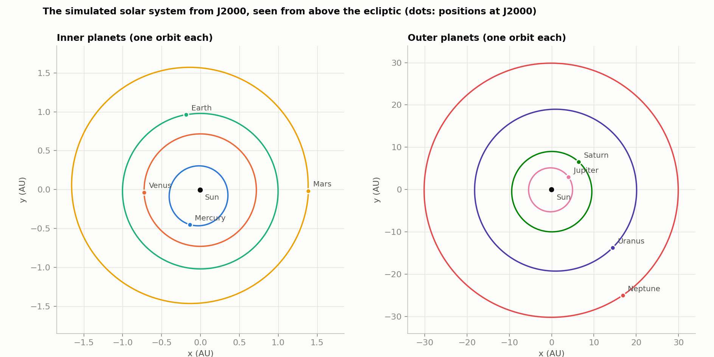
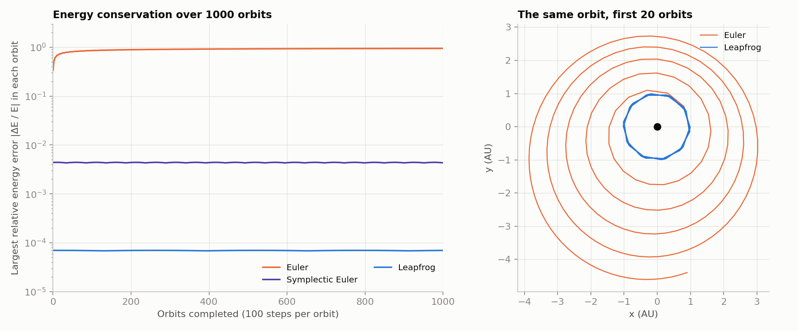
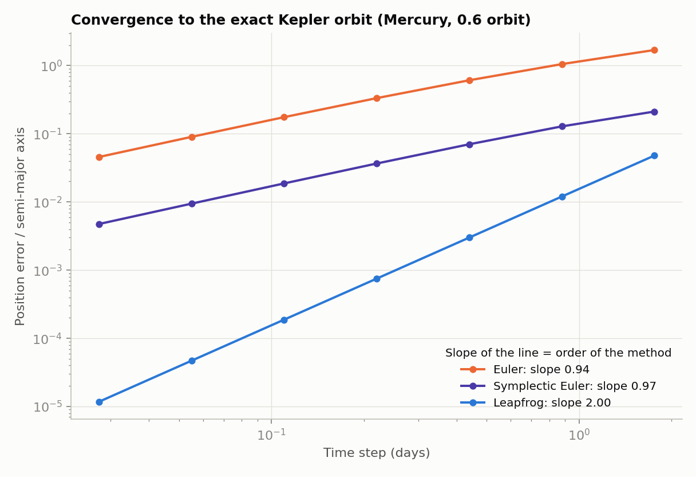
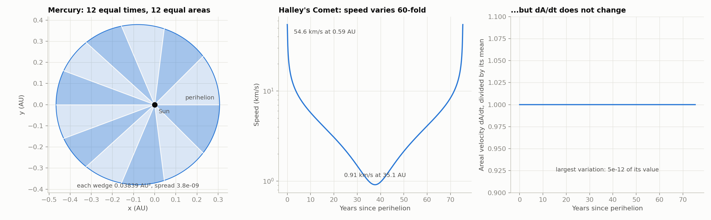
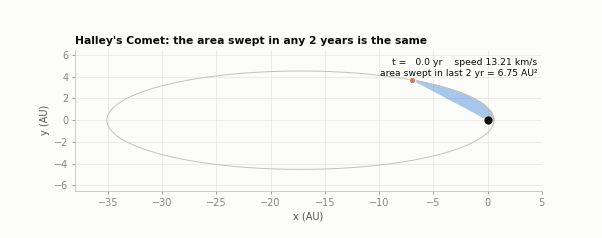
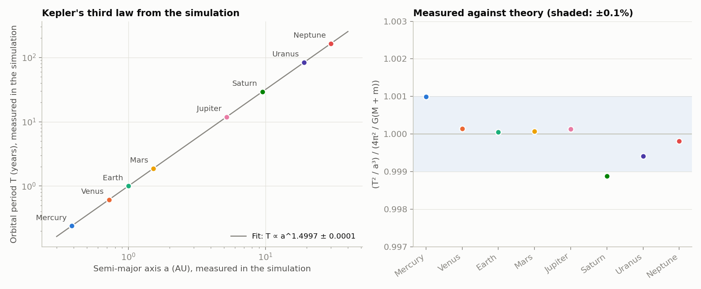
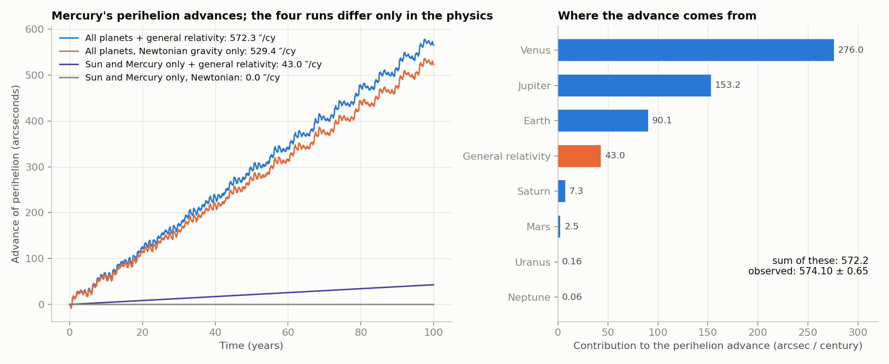

# Solar system orbital simulator: Newton's gravity, Kepler's laws and Mercury's perihelion

A Python N-body simulator of the Sun and the eight planets, built from Newton's law of gravitation alone. It starts from real planetary positions (JPL, J2000), integrates the motion with three different numerical methods, and then does what Kepler and Einstein did with the results: it measures Kepler's three laws from the simulated orbits, and reproduces the famous anomaly in the orbit of Mercury, whose perihelion advances by about 574 arcseconds per century, of which Newtonian gravity explains only 532. Adding one relativistic correction accounts for most of the rest.



## Headline results

| Test | Result |
|---|---|
| Whole solar system, 340 years, 248,370 leapfrog steps of 0.5 d | energy varies by **7 × 10⁻⁷**, angular momentum by **3 × 10⁻¹⁴** |
| Order of accuracy, measured against the exact Kepler orbit | Euler **0.94**, symplectic Euler **0.97**, leapfrog **2.00** |
| Energy error after 1000 orbits at 100 steps/orbit | Euler 0.94 (useless), symplectic Euler bounded but larger (worst 4 × 10⁻³), leapfrog **7 × 10⁻⁵ and not growing** |
| Kepler's 2nd law | 12 equal-time wedges of Mercury's orbit differ in area by **4 × 10⁻⁹**; Halley's comet speed varies 60-fold while dA/dt varies by 5 × 10⁻¹² |
| Kepler's 3rd law, all eight planets | T ∝ a^k with **k = 1.4997 ± 0.0001** (theory: 1.5) |
| Mercury's perihelion, Sun + Mercury + general relativity | **42.98 ″/century**, analytic value 42.98 |
| Mercury's perihelion, all planets, Newtonian only | **529.4 ″/century** (published planetary value 532.3) |
| Mercury's perihelion, all planets + general relativity | **572.3 ″/century** (observed 574.10 ± 0.65) |

- **Leapfrog is only second-order, but it behaves much better than its order suggests.** After 1000 orbits its energy error is no bigger than after ten (7 × 10⁻⁵), because it is symplectic. Plain Euler, with the same step, gains energy on every orbit until the orbit is useless (error 0.94).
- **The precession is a sum of many small tugs.** Venus contributes 276 ″/cy, Jupiter 153, Earth 90 and Saturn 7. General relativity adds 43. All of them have to be right to get near the observed number.
- Two of my numbers miss the published ones slightly and I have not been able to remove the discrepancy. See [Limitations](#limitations).

## How this was built

I've been teaching myself Python alongside my A-level studies. I built this project with Claude (Anthropic's AI assistant), which wrote most of the code. I chose the problem and what to test, and I'm working through the code, including the NumPy, to understand the numerical methods in detail.

## Run it

```bash
python3 -m venv .venv && source .venv/bin/activate
pip install -r requirements.txt
python run_experiments.py
open figures/fig6_mercury_precession.png        # macOS
```

Everything is computed from scratch, needs no internet, and takes about two minutes. It writes six figures and two animations to `figures/`, and every number it prints to `results.json`.

| Option | What it does |
|---|---|
| `--quick` | Shorter runs (about 15 seconds). The precession numbers are less accurate and Figure 6 is skipped. |
| `--no-animation` | Skip the two GIFs. |
| `--out-dir DIR` | Write figures somewhere else. |
| `--results FILE` | Write the numbers somewhere else. |

To use the simulator as a library:

```python
import orbital_simulator as sim

system = sim.solar_system()                                   # Sun + 8 planets at J2000, barycentric frame
traj = sim.run(system, "leapfrog", 0.5 * sim.DAY, 20_000)     # 27 years
r, v = sim.relative_orbit(traj.pos, traj.vel, system.index("Mars"))   # Mars relative to the Sun
print(sim.total_energy(traj.pos, traj.vel, traj.mass)[[0, -1]])
```

## How it works

### Units

Lengths in astronomical units, time in Julian years, mass in solar masses. In these units the gravitational constant times the Sun's mass is `G = 39.4769`, which is 4π² to within 4 × 10⁻⁵ (the Earth's orbit is not exactly 1 AU, and it is the Earth–Moon system that orbits). Working in these units keeps every number near 1 and makes Kepler's third law readable: `T² = a³` for a planet of negligible mass. The speed of light is 63,241 AU/yr, needed only for the relativity correction.

### Starting positions

The initial condition for each planet comes from the mean Keplerian elements at J2000 published by the JPL Solar System Dynamics group (Standish, Table 1, valid 1800–2050): semi-major axis, eccentricity, inclination, mean longitude, longitude of perihelion and longitude of the ascending node. The code

1. solves Kepler's equation `E − e sin E = M` for the eccentric anomaly with Newton's method (starting from `E = π` for very eccentric orbits, where starting from `M` can fail),
2. builds the position and velocity in the orbital plane,
3. rotates them into the ecliptic frame with the three angles `Rz(Ω) Rx(i) Rz(ω)`,
4. shifts everything into the frame where the centre of mass of the whole system is at rest at the origin.

"Earth" is the Earth–Moon barycentre with the mass of both. Each planet's mass includes its moons. After step 4 the total momentum is zero to 10⁻¹⁷, and it stays that way.

### Physics

Every body attracts every other, `aᵢ = G Σⱼ mⱼ (rⱼ − rᵢ) / |rⱼ − rᵢ|³`, so the Sun moves too. This matters: Jupiter drags the Sun about 0.005 AU (roughly a solar radius) around the barycentre, which changes the apparent orbits of the outer planets by half a percent.

### Three integrators

| Method | Order | Symplectic | What it does |
|---|---|---|---|
| Euler | 1 | no | `x += v dt; v += a dt` using the old values |
| Symplectic Euler | 1 | yes | `v += a dt`, then `x += v dt` with the *new* `v` |
| Leapfrog (velocity Verlet) | 2 | yes | half kick, drift, half kick |

Symplectic methods have a structural advantage: they do not conserve the true energy, but they exactly conserve a slightly different "shadow" energy that stays close to the true one forever. So the energy error oscillates and never accumulates. Leapfrog and symplectic Euler also conserve angular momentum *exactly* (to round-off), because every kick is along the line to the centre. Euler does not: it adds angular momentum every step and its orbits spiral outwards (Figure 2, right).

For Halley's Comet and for the precession experiment the code instead uses SciPy's `solve_ivp` (an adaptive 8th-order Dormand–Prince method, DOP853) at a relative tolerance of 10⁻¹², as a high-accuracy reference solver. It is not one of the three methods being compared. A precession of one part in 10⁷ per orbit needs a solver that adds almost no error of its own, and Halley's very eccentric orbit would need a tiny fixed step.





The convergence figure compares each method with the exact solution of the Kepler problem (Mercury's orbit, e = 0.206) and plots position error against step size. The slope of each line is the order of the method. It is measured after 0.6 of an orbit, not a whole one: at exactly one period, symplectic Euler happens to be much more accurate than its order suggests (the errors from the first and second halves of the orbit cancel), which would hide the fact that it is only first order.

## Kepler's three laws, measured

None of Kepler's laws is put into the simulation. Only Newton's law of gravity is. The laws are measured from the orbits that come out.

**First law: orbits are ellipses with the Sun at one focus.** The equation of a conic is `r(φ) = p / (1 + e cos φ)`, so `1/r = A + B cos φ + C sin φ`, which is linear in the unknowns. The code fits it to each simulated orbit by linear least squares. Mercury, Venus, Earth, Mars and the giants all fit to within 6 × 10⁻⁴ of `1/r` at the worst point, and the fitted eccentricities agree with JPL's (Mercury 0.2054 fitted, 0.2056 in the table).

**Second law: equal areas in equal times.** Figure 4 (left) splits Mercury's orbit into 12 equal time intervals and measures each wedge's area by summing triangles from the positions alone. That is a geometric measurement that does not use angular momentum. The areas are equal to 4 × 10⁻⁹ and add up to the ellipse's area. The middle and right panels show Halley's comet, which moves 60 times faster at perihelion than at aphelion, yet sweeps out area at a constant rate.





**Third law: T² ∝ a³.** The simulation measures every planet's period (the time for the longitude to advance by 2π, averaged over all the orbits in the run) and its mean osculating semi-major axis. A straight line fitted through `log T` against `log a` has slope 1.4997 ± 0.0001.

| Planet | Orbits simulated | Period (yr) | vs JPL | T² / a³ against theory |
|---|---|---|---|---|
| Mercury | 1411 | 0.2409 | +0.04% | 1.0010 |
| Venus | 552 | 0.6152 | +0.01% | 1.0001 |
| Earth | 339 | 1.0001 | +0.00% | 1.0001 |
| Mars | 180 | 1.8809 | +0.00% | 1.0001 |
| Jupiter | 28 | 11.858 | −0.04% | 1.0001 |
| Saturn | 11 | 29.24 | −0.69% | 0.9989 |
| Uranus | 4 | 83.73 | −0.34% | 0.9994 |
| Neptune | 2 | 164.5 | −0.15% | 0.9998 |



For the outer planets the code measures each orbit about the centre of mass of everything *inside* it (a Jacobi coordinate), not about the Sun. Otherwise the Sun's 0.005 AU wobble from Jupiter shows up as a 0.5% wobble in the "heliocentric" semi-major axes of Saturn, Uranus and Neptune, and the third law appears to fail for a reason that has nothing to do with gravity.

## Mercury's perihelion

Mercury's orbit is an ellipse, but the ellipse slowly rotates: the point of closest approach to the Sun, the perihelion, advances by 574 arcseconds (0.16°) per century. In 1859 Le Verrier showed that Newtonian gravity, including the pull of the other planets, could not account for all of it. Newcomb later refined the unexplained part to about 43 ″/cy, and it stayed a puzzle until Einstein's 1915 general relativity predicted almost exactly that amount, one of the first tests the theory passed. The modern breakdown of the 574 is 532.30 from the planets, 42.98 from general relativity, and two tiny terms (0.03 from the Sun's oblateness and −0.002 from frame dragging), which sum to 575.3.

The code measures it by integrating Mercury's orbit and, at every output time, computing the orbital elements from the instantaneous position and velocity (the eccentricity vector `e = (v × h)/μ − r/|r|` points to perihelion). It then fits a straight line to the longitude of perihelion. Four runs differ only in the physics:

| Run | Precession (″/century) | Expected |
|---|---|---|
| Sun + Mercury, Newtonian | 0.001 | 0: an inverse-square force gives a closed ellipse |
| Sun + Mercury + general relativity | 42.982 ± 0.002 | 42.980 (analytic) |
| All planets, Newtonian | 529.4 ± 0.3 | 532.3 (published) |
| All planets + general relativity | 572.3 ± 0.3 | 574.10 ± 0.65 (observed) |

The general-relativity term is the first post-Newtonian correction to the acceleration of a test body,

`a_GR = (GM / c²r³) [ (4GM/r − v²) r + 4 (r·v) v ]`,

which produces a perihelion advance of `6πGM / (c² a (1 − e²))` per orbit: 0.103 arcseconds every 88 days. The simulation recovers the analytic 42.98 ″/cy from the differential equation to 0.01%, which tests the implementation end to end.

The contribution of each planet is found by simulating Mercury with the Sun and just that one planet:



Venus (276) and Jupiter (153) dominate, with the Earth (90) third. Neptune's contribution is 0.06 ″/cy.

The precession is measured as the *longitude of perihelion* ϖ = Ω + ω (node plus argument of perihelion), the quantity tabulated in planetary elements. Taking the angle of the eccentricity vector projected on the ecliptic instead is wrong by several arcseconds per century for an inclined orbit like Mercury's. I made that mistake at first, and it gave 526.5 instead of 529.4.

## Limitations

- **My planetary precession is 0.55% below the published value** (529.4 against 532.3), and the total is 1.75 ″/cy below the observed 574.10 ± 0.65. The formal fitting uncertainty is only ±0.3. I think the cause is that the initial conditions use *mean* orbital elements while the simulation evolves *osculating* ones, which differ slightly, and Mercury's precession is sensitive to Venus's and the Earth's orbits. I have not tested this. Note that the published contributions sum to 575.31, itself 1.2 ″/cy above the observed value, so the observation is not a sharp target either.
- **The third-law slope is formally about 5σ from 1.5.** The uncertainty on the slope treats the scatter as random, but the deviations are systematic at the ~0.1% level. For the inner planets they come from the time step (see the next point) and for the outer ones from mutual perturbations and mean-versus-osculating elements. So the quoted ±0.0001 is optimistic, and the honest statement is that the law holds to about 0.1%.
- **Mercury's third-law ratio (1.0010) is largely the time step.** Leapfrog's phase error stretches the period by an amount proportional to `dt²`. With only 176 steps per Mercury orbit that costs 0.07% in `T²/a³`; halving the step cuts it by four (I checked in a Sun–Mercury run: the period error is 0.30%, 0.075%, 0.019%, 0.005% for steps of 1, 0.5, 0.25 and 0.125 days). I did not investigate the remaining 0.03%; the other planets' perturbations are the obvious candidate.
- **Saturn's period is 0.69% short and Uranus's 0.34%.** The JPL rates are long-term averages, and over 340 years (11 Saturn orbits, 4 of Uranus) the actual period is modulated by the Jupiter–Saturn interaction. I expect that this explains most of it, but I have not separated it from the mean-versus-osculating offset above.
- **Only Newtonian gravity between the planets, only Mercury has relativity, and only to first order.** GR is applied to Mercury as a test particle in the Sun's field, with the reaction on the Sun included. The other planets' relativistic corrections and the coupling between GR and the planetary perturbations are neglected, as are the Sun's oblateness (0.03 ″/cy), frame dragging (−0.002 ″/cy) and the Moon's separate motion.
- **It is not an ephemeris.** The starting elements are only valid for 1800–2050, and I checked the simulation against exact Kepler solutions and conservation laws, not against JPL Horizons positions. Over millions of years the solar system is chaotic and no code of this kind can predict it; over the 340 years used here that does not matter.
- **Halley's comet is two-body only.** Its real period wanders between 74 and 79 years because of planetary perturbations and jets of gas from the nucleus. The simulation gives a clean 75.3 years, because it is used only to show the second law.
- **Animations are for illustration.** The inner-planet GIF shows the first two years of the full simulation; the Halley GIF shows one orbit with the area swept in the last two years shaded.

## Tests

```bash
python test_orbital_simulator.py
```

39 tests, none needing the internet, running in about half a minute. They check:

- the units and the planet table, Kepler's equation for every eccentricity up to 0.99, and that the starting state has the right energy, angular momentum, perihelion and aphelion
- Earth's position and speed at J2000 (0.98331 AU, 30.29 km/s), and that the solar system starts with the centre of mass at rest
- Newton's law of gravitation and Newton's third law, the potential energy, and the energy of a Kepler orbit
- that leapfrog and symplectic Euler conserve angular momentum to round-off and Euler does not, that leapfrog's energy error is bounded while Euler's grows, and that each method converges at its stated order
- that the reference solver closes a Kepler orbit to 10⁻⁸ AU
- the measurement code on cases with known answers: a circle for the period finder (both directions), an exact ellipse in a tilted plane for the first-law fit, and a distorted orbit to check that the fit *can* fail; a synthetic third-law fit; a quarter circle for the swept area; and the Jacobi-coordinate helpers
- the analytic relativistic precession (42.98 ″/cy), the size and direction of the relativistic force on a circular orbit, that a Newtonian two-body orbit does not precess, that the relativistic one does at the analytic rate, and that the longitude of perihelion is `Ω + ω` for known angles
- that every experiment runs, every figure is drawn, both GIFs have the right number of frames, and that `run_experiments.py --quick` works from start to finish

## Ideas to extend it

- Compare the positions against JPL Horizons and measure how quickly the mean-element start drifts from the real ephemeris.
- Add the Moon as its own body, and Pluto, and see what changes.
- Use a Wisdom–Holman or other higher-order symplectic integrator, and measure how much larger a step it allows.
- Test whether the solar system is chaotic: change one planet's starting position by 1 metre and measure how the difference grows.
- Plan a Hohmann transfer to Mars in the simulation, and find the launch window.

## Credits and references

- Standish, E. M., *Keplerian Elements for Approximate Positions of the Major Planets*, JPL Solar System Dynamics (Table 1, 1800–2050 AD): the starting orbital elements
- IAU 2012 (astronomical unit) and IAU 2015 Resolution B3 (nominal solar `GM`); planetary mass ratios from JPL Solar System Dynamics
- JPL Small-Body Database: Halley's comet (`a = 17.834 AU`, `e = 0.96714`)
- Clemence, G. M. (1947), *Rev. Mod. Phys.* 19, 361: the observed 574.10 ± 0.65 ″/cy of Mercury's perihelion
- Park, R. S. et al. (2017), *Astron. J.* 153, 121: Mercury's precession measured with MESSENGER, and the 42.98 ″/cy relativistic value
- The breakdown 532.30 (planets) + 0.03 (solar oblateness) + 42.98 (GR) − 0.002 (frame dragging) = 575.31 is tabulated in the Wikipedia article "Tests of general relativity"
- Einstein, A. (1915), *Sitzungsberichte der Preussischen Akademie der Wissenschaften*, 831: the explanation of Mercury's perihelion
- Le Verrier, U. (1859) and Newcomb, S. (1882): the discovery and refinement of the anomaly
- Hairer, E., Lubich, C. and Wanner, G., *Geometric Numerical Integration* (Springer): symplectic integrators and their energy behaviour
- Hairer, E., Nørsett, S. P. and Wanner, G., *Solving Ordinary Differential Equations I*: the DOP853 method used by SciPy
